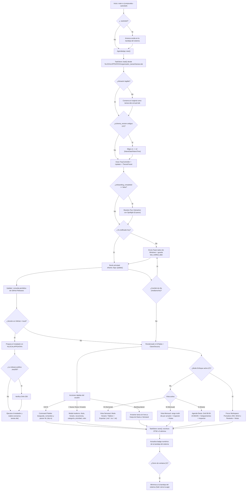

<div align="center">
  
  <h1>Mi Agenda</h1>
  <p><strong>Aplicación de escritorio en Rust para planificación personal, time-blocking, modo enfoque y vista semanal.</strong></p>

  
  
  
  [](https://github.com/AlejandroEspinosaLeal/agenda/actions/workflows/ci.yml)
  [](LICENSE)

  <p><a href="README.md">English</a> | <strong>Español</strong></p>
</div>

---

## Características principales

- **Tres vistas interactivas de planificación**:
  - **Calendario Mensual**: cuadrícula de 7 columnas con badge de `HOY`, botón `+` al pasar el ratón, hasta 3 bloques por celda + `+N más`, **selección por arrastre multi-día** para crear tareas de varios días de una vez, e inspector lateral colapsable con notas rápidas autoguardadas.
  - **Agenda Diaria**: rejilla horaria real (`06:00–23:00` o `24h`) con franja de `Todo el día`, línea en vivo de hora actual (`ACTUAL`), algoritmo en Rust puro para mostrar bloques solapados en columnas paralelas y resumen de ritmo diario.
  - **Vista Semanal**: modo dual **Horario** (rejilla compartida de 7 días) y **Tablero**, pie analítico colapsable (horas por categoría, `Intención de la Semana`, balance de carga) y menú de exportación.
- **Interacción directa y Backlog**:
  - Haz clic o arrastra sobre franjas vacías (ajuste automático a 15 min) para crear bloques, arrástralos entre horas o días, estira su duración desde el borde inferior y arrastra tareas de la bandeja **Sin Programar (Backlog)** directamente al calendario.
- **Paleta de Comandos (`Ctrl+K`) y Entrada Natural**:
  - Modal centrado para buscar tareas/eventos/notas, ejecutar comandos y crear bloques escribiendo natural (ej. `"Estudiar Rust 18:00-19:30 #Estudio"` o `"Reunión mañana 10:00 1h #Trabajo"`).
  - **Navegación con flechas** (`↑` / `↓`) por resultados y comandos, con `Enter` para abrir la opción resaltada.
- **Modo Enfoque (`F`)**:
  - Oculta barras laterales, centra el bloque activo y muestra un temporizador configurable **Pomodoro (`25/5`) / Deep Work (`50/10`) / Restante del bloque** junto a sus notas. El temporizador solo repinta mientras hay una sesión en marcha.
- **Exportación real**:
  - Exporta tu semana a **Markdown (`.md`)**, texto plano (`.txt`) o **iCalendar estándar (`.ics` RFC 5545)** con `VCALENDAR`/`VEVENT`/`RRULE`.
- **Paletas de colores, accesibilidad y flujo de teclado**:
  - 6 paletas persistentes (**Índigo**, **Océano**, **Bosque**, **Terracota**, **Rosa**, **Lavanda**) con modo claro u oscuro, ajustadas para cumplir **contraste WCAG AA en temas oscuros** (texto, checkboxes y botones).
  - El modal de Nueva Tarea enfoca automáticamente el campo de título, de modo que `C` → escribir → `Enter` funciona sin usar el ratón.
- **Guía interactiva de bienvenida (`?`)**:
  - Tour con spotlight en el primer uso que recorre automáticamente Mensual, Semanal, Diaria, Backlog, `Ctrl+K`, Modo Enfoque y Paletas/Notificaciones (repetible en cualquier momento desde el botón `?`).
- **Integración con Windows y Auto-actualizador**:
  - **Notificación diaria nativa en Windows** una vez al día al iniciar o cambiar de día con tus pendientes (también disponible desde la bandeja o `Ctrl+K`).
  - **Icono en la bandeja del sistema** (`tray-icon`) con insignia numérica. `--autostart` arranca la app **oculta** en la bandeja, cerrar la ventana con `X` **minimiza a la bandeja** y **Salir** en el menú de la bandeja cierra la aplicación.
  - **Actualización automática desde GitHub Releases**: consulta `releases/latest`, prepara el instalador en una carpeta privada dentro de `%LOCALAPPDATA%` y verifica el checksum **SHA-256** publicado cuando la release incluye un asset `.sha256`. Los valores que se pasan a PowerShell viajan mediante **variables de entorno**, sin interpolación de cadenas con datos de tareas ni URLs.
- **Seguridad de datos y recurrencias**:
  - La persistencia usa el formato **`OTSK` v2** y es **retrocompatible con los archivos `tareas.dat` existentes** (los datos legacy v1 se migran al cargar).
  - Las escrituras son **atómicas** (archivo temporal + reemplazo) y un almacén ilegible se conserva como **`tareas.dat.corrupt.bak`** para no perder los bytes originales.
  - Las tareas recurrentes guardan **estado por ocurrencia**: completar u omitir una ocurrencia afecta solo a esa fecha, no a toda la serie. Las fechas y el indicador de hora actual usan **hora local**.

---

## Instalación (Windows)

1. Descarga **`Mi_Agenda_Setup.exe`** desde la última versión en [Releases](https://github.com/AlejandroEspinosaLeal/agenda/releases).
2. Ejecuta el instalador (no requiere permisos de administrador).
3. Opcionalmente deja marcada la casilla **Iniciar automáticamente con Windows** para recibir la notificación diaria y tener el icono en la bandeja al encender el PC.

---

## Compilación desde el código fuente

Requisitos: **Windows 10/11**, **Rust stable** con toolchain MSVC (Visual Studio Build Tools) y, opcionalmente, **Inno Setup 6** para empaquetar el instalador. El proyecto usa **Rust 2021** con **eframe/egui 0.29**.

```powershell
cargo fmt --all -- --check
cargo clippy --all-targets -- -D warnings
cargo test
cargo build --release
```

El binario de release se genera en `target\release\organizador_tareas.exe`.

Para generar también el instalador:

```powershell
& "C:\Program Files (x86)\Inno Setup 6\ISCC.exe" installer.iss
```

---

## Integración continua

`.github/workflows/ci.yml` se ejecuta en `windows-latest` en cada push y pull request a `main`, además de ejecuciones manuales:

- `cargo fmt --all -- --check`
- `cargo clippy --all-targets -- -D warnings`
- `cargo test`

Las ejecuciones antiguas se cancelan automáticamente mediante `concurrency`. En tags que coinciden con `v*`, tras superar las comprobaciones, un job de release ejecuta `cargo build --release`, genera `organizador_tareas.exe.sha256` con `Get-FileHash` y adjunta el binario y el checksum a la GitHub Release.

---

## Estructura del proyecto

```text
organizador_tareas/
├── .github/
│   └── workflows/ci.yml   # Formato, Clippy, tests y assets de release por tag
├── assets/
│   └── icon.ico          # Icono multi-resolución de la aplicación (16..256 px)
├── src/
│   ├── main.rs           # Punto de entrada y soporte de flag --autostart
│   ├── app.rs            # Estado principal, cabecera, sidebar, Ctrl+K y Modo Enfoque
│   ├── calendar.rs       # Lógica de calendario civil, semanas ISO y fechas locales
│   ├── export.rs         # Exportadores Markdown (.md), texto (.txt) e iCalendar RFC 5545 (.ics)
│   ├── focus.rs          # Máquina de estados del temporizador Pomodoro / Deep Work
│   ├── model.rs          # Modelo v2 (chrono), estado por ocurrencia y persistencia OTSK atómica
│   ├── nlp.rs            # Parser de entrada rápida en lenguaje natural para Ctrl+K
│   ├── theme.rs          # Paletas claro/oscuro, tokens WCAG AA, espaciados, radios y categorías
│   ├── timeblock.rs      # Algoritmo de solapamientos en columnas y ajuste a 15 min
│   ├── tour.rs           # Guía interactiva multi-vista con spotlight
│   ├── tray.rs           # Bandeja del sistema, arranque oculto y notificaciones Toast diarias
│   ├── updater.rs        # Descarga desde GitHub Releases con verificación SHA-256 y staging en %LOCALAPPDATA%
│   └── views/
│       ├── mod.rs        # Helpers visuales compartidos y filtros de categoría
│       ├── monthly.rs    # Vista Calendario Mensual con arrastre multi-día e inspector
│       ├── daily.rs      # Vista Agenda Diaria con rejilla horaria
│       └── weekly.rs     # Vista Semanal dual (Horario / Tablero)
├── build.rs              # Incrustación de icon.ico en Windows mediante winresource
├── Cargo.toml            # Dependencias (chrono, eframe, serde, serde_json, tray-icon)
├── installer.iss         # Script de Inno Setup 6 para Mi_Agenda_Setup.exe
└── LICENSE               # Licencia MIT
```

---

## Atajos de teclado

| Atajo | Acción |
| --- | --- |
| `Ctrl + K` | Abrir paleta de comandos y entrada rápida en lenguaje natural; `↑` / `↓` navegan y `Enter` abre la selección |
| `Ctrl + F` | Enfocar el filtro de búsqueda de la vista |
| `M` / `W` / `D` | Cambiar a vista Mensual / Semanal / Diaria |
| `T` | Ir a Hoy |
| `C` | Abrir modal de Nueva Tarea / Evento con el campo de título enfocado |
| `F` | Activar / Salir de Modo Enfoque |
| `←` / `→` | Mes, semana o día anterior / siguiente |
| `Esc` | Cerrar paleta, modal, guía, Modo Enfoque o inspector |

Cerrar la ventana con `X` mantiene Mi Agenda en la bandeja del sistema; usa **Salir** en el menú de la bandeja para cerrarla por completo.

---

## Diagrama de flujo de la aplicación



---

## Licencia

Publicado bajo la **licencia MIT**. Copyright © 2026 **Alejandro Espinosa Leal**. Consulta [LICENSE](LICENSE) para el texto completo.
