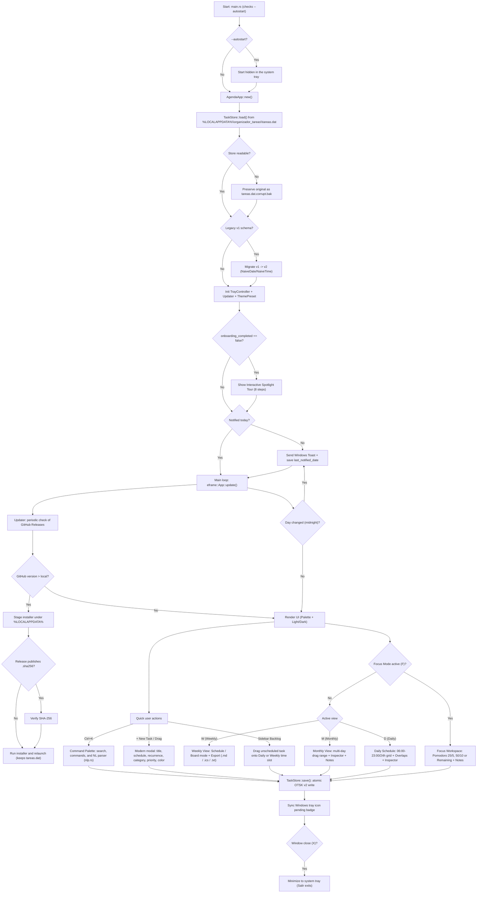

<div align="center">
  
  <h1>Mi Agenda</h1>
  <p><strong>A lightweight Rust desktop application for personal planning, time-blocking, daily focus, and weekly overview.</strong></p>

  
  
  
  [](https://github.com/AlejandroEspinosaLeal/agenda/actions/workflows/ci.yml)
  [](LICENSE)

  <p><strong>English</strong> | <a href="README.es.md">Español</a></p>
</div>

---

## Key Features

- **Three Interactive Planning Views**:
  - **Monthly Calendar (`Calendario Mensual`)**: 7-column grid with Today badge (`HOY`), hover `+` quick-add, up to 3 compact blocks per cell + `+N más`, **multi-day drag selection** to create multi-day tasks/events at once, and a collapsible contextual right-hand inspector with debounced daily notes.
  - **Daily Schedule (`Agenda Diaria`)**: real `06:00–23:00` (expandable to `24h`) time-blocking grid with an `All Day` strip, live current-time indicator (`ACTUAL`), pure-Rust parallel overlap column layout, and daily rhythm summary.
  - **Weekly View (`Vista Semanal`)**: dual **Schedule Mode** (shared 7-day hourly grid) and **Board Mode**, collapsible analytical footer (category hours, `Intención de la Semana`, workload balance), and export menu.
- **Direct Manipulation & Backlog**:
  - Click or drag on empty time slots (15-min snap) to create blocks, drag blocks across hours/days, resize duration from the bottom handle, and drag unscheduled tasks from the sidebar **Backlog** directly onto the calendar.
- **Command Palette (`Ctrl+K`) & Natural Language Entry**:
  - Centered modal to search tasks/events/notes, run quick commands, and create blocks using natural language (e.g. `"Estudiar Rust 18:00-19:30 #Estudio"` or `"Reunión mañana 10:00 1h #Trabajo"`).
  - **Arrow-key navigation** (`↑` / `↓`) through results and commands, with `Enter` opening the highlighted selection.
- **Focus Mode (`F`)**:
  - Hides sidebars, centers the active block, and runs a configurable **Pomodoro (`25/5`) / Deep Work (`50/10`) / Remaining Block** timer alongside session notes. The timer only repaints while a session is running.
- **Real Export**:
  - Export weekly summaries to **Markdown (`.md`)**, plain text (`.txt`), or standard **iCalendar (`.ics` RFC 5545)** with `VCALENDAR`/`VEVENT`/`RRULE`.
- **Color Palettes, Accessibility & Keyboard Flow**:
  - 6 persisted palettes (**Índigo**, **Océano**, **Bosque**, **Terracota**, **Rosa**, **Lavanda**) with Light/Dark mode, tuned for **WCAG AA contrast in dark themes** (text, checkboxes, and buttons).
  - The New Task modal focuses the title field automatically, so `C` → type → `Enter` works without touching the mouse.
- **Interactive Onboarding Tour (`?`)**:
  - First-launch spotlight walkthrough that automatically navigates across Monthly, Weekly, Daily, Backlog, `Ctrl+K`, Focus Mode, and Color Palettes/Notifications (replayable anytime via `?`).
- **Windows Integration & Auto-Updater**:
  - **Daily Windows Toast Notification** once per day at launch/midnight with today's pending items (also triggerable from the tray menu or `Ctrl+K`).
  - **System Tray Icon** (`tray-icon`) with live pending badge. `--autostart` launches the app **hidden** in the tray, closing the window with `X` **minimizes to the tray**, and **Salir** in the tray menu exits the application.
  - **Automatic GitHub Releases Updater**: checks `releases/latest`, stages the installer in a private folder under `%LOCALAPPDATA%`, and verifies the published **SHA-256** checksum when the release includes a `.sha256` asset. Values handed to PowerShell travel through **environment variables**, with no string interpolation of task data or URLs.
- **Data Safety & Recurrences**:
  - Persistence uses the **`OTSK` v2** format and remains **backward compatible with existing `tareas.dat` files** (legacy v1 data is migrated on load).
  - Saves are **atomic** (temporary file + replace), and an unreadable store is preserved as **`tareas.dat.corrupt.bak`** so the original bytes are not lost.
  - Recurring tasks keep **per-occurrence state**: completing or skipping one occurrence only affects that date, not the whole series. Dates and the current-time indicator use **local time**.

---

## Installation (Windows)

1. Download **`Mi_Agenda_Setup.exe`** from the latest [Releases](https://github.com/AlejandroEspinosaLeal/agenda/releases).
2. Run the installer (no administrator privileges required).
3. Optionally keep **Iniciar automáticamente con Windows** checked so daily notifications and the tray icon run on login.

---

## Building from Source

Requirements: **Windows 10/11**, **Rust stable** with the MSVC toolchain (Visual Studio Build Tools), and optionally **Inno Setup 6** to package the installer. The project uses **Rust 2021** with **eframe/egui 0.29**.

```powershell
cargo fmt --all -- --check
cargo clippy --all-targets -- -D warnings
cargo test
cargo build --release
```

The release binary is written to `target\release\organizador_tareas.exe`.

To build the installer as well:

```powershell
& "C:\Program Files (x86)\Inno Setup 6\ISCC.exe" installer.iss
```

---

## Continuous Integration

`.github/workflows/ci.yml` runs on `windows-latest` for every push and pull request to `main`, plus manual dispatches:

- `cargo fmt --all -- --check`
- `cargo clippy --all-targets -- -D warnings`
- `cargo test`

Runs for older commits are cancelled automatically via `concurrency`. On tags matching `v*`, after the checks pass, a release job builds `cargo build --release`, generates `organizador_tareas.exe.sha256` with `Get-FileHash`, and attaches the binary and checksum to the GitHub Release.

---

## Project Structure

```text
organizador_tareas/
├── .github/
│   └── workflows/ci.yml   # Format, Clippy, tests, and tagged release assets
├── assets/
│   └── icon.ico          # Multi-resolution application icon (16..256 px)
├── src/
│   ├── main.rs           # Entry point and --autostart flag handling
│   ├── app.rs            # Main state, header, sidebar, Command Palette, Focus Mode
│   ├── calendar.rs       # Civil calendar math, ISO weeks, and local-date helpers
│   ├── export.rs         # Markdown (.md), text (.txt) and RFC 5545 iCalendar (.ics) exporters
│   ├── focus.rs          # Focus/Pomodoro timer state machine
│   ├── model.rs          # v2 Task/Event model (chrono), per-occurrence state, atomic OTSK persistence
│   ├── nlp.rs            # Natural-language quick-entry parser for Ctrl+K
│   ├── theme.rs          # Light & dark palettes, WCAG AA tokens, spacing, radius, categories
│   ├── timeblock.rs      # Interval overlap partitioning and 15-min snap helpers
│   ├── tour.rs           # Interactive multi-view spotlight onboarding tour
│   ├── tray.rs           # System tray icon, hidden autostart, and daily Toast notifications
│   ├── updater.rs        # GitHub Releases downloader with SHA-256 verification and %LOCALAPPDATA% staging
│   └── views/
│       ├── mod.rs        # Shared UI helpers and unified category filter bar
│       ├── monthly.rs    # Monthly view with multi-day drag and inspector
│       ├── daily.rs      # Daily time-blocking grid view
│       └── weekly.rs     # Dual Schedule/Board weekly view
├── build.rs              # Embeds icon.ico into Windows binary via winresource
├── Cargo.toml            # Dependencies (chrono, eframe, serde, serde_json, tray-icon)
├── installer.iss         # Inno Setup 6 script for Mi_Agenda_Setup.exe
└── LICENSE               # MIT license
```

---

## Keyboard Shortcuts

| Shortcut | Action |
| --- | --- |
| `Ctrl + K` | Open Command Palette & quick natural-language entry; `↑` / `↓` navigate, `Enter` opens the selection |
| `Ctrl + F` | Focus view filter search |
| `M` / `W` / `D` | Switch to Monthly / Weekly / Daily view |
| `T` | Jump to Today |
| `C` | Open New Task / Event modal with the title field focused |
| `F` | Toggle Focus Mode |
| `←` / `→` | Previous / next month, week, or day |
| `Esc` | Close Command Palette, modal, tour, Focus Mode, or inspector |

Closing the window with `X` keeps Mi Agenda running in the system tray; use **Salir** in the tray menu to exit completely.

---

## Application Flowchart



---

## License

Released under the **MIT License**. Copyright © 2026 **Alejandro Espinosa Leal**. See [LICENSE](LICENSE) for the full text.
